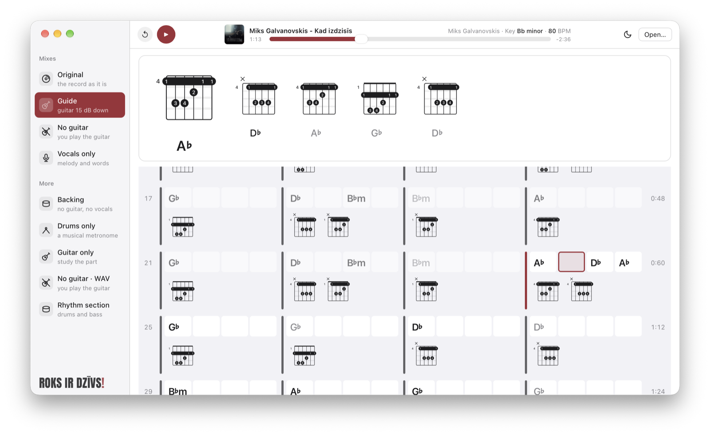

# playalong

> **Heads up to [Miks Galvanovskis](https://www.youtube.com/watch?v=HUHwtDRaHXw).** His
> "Kad izdzisīs" is the song this app was built and tuned on, and the one in the screenshot below.
> Go listen to the original. **Roks ir dzīvs!**

Download a song from YouTube (or use a local file), split it into instrument stems, and render
playalong tracks, mainly for practising guitar.

Two parts: a command-line tool (`src/`) that makes everything, and a small macOS [player app](#player-app)
(`app/`) that runs it for you and plays a mix with the chords following along.


*Playing "Kad izdzisīs" by Miks Galvanovskis.*

Separation uses the BS-RoFormer-SW 6-stem model (`bass`, `drums`, `other`, `vocals`,
`guitar`, `piano`) via [bs-roformer-infer](https://github.com/openmirlab/bs-roformer-infer).

## Setup

```sh
brew install ffmpeg deno   # deno lets yt-dlp solve YouTube's JS challenges
uv sync
```

The model weights (~700 MB) download to `~/.cache/bs-roformer-infer` on first use.

## Usage

```sh
# a new song in one go: download, album cover, separate, chords and the song file, plus its default mixes
# (Original, Guide, No guitar) as recipes in mixes.json that the app plays live; --garageband adds the stems
uv run playalong run "https://www.youtube.com/watch?v=..."

# age-restricted videos need your YouTube login: the default browser's is used when YouTube asks
# (Safari's needs Full Disk Access for the terminal app); name another browser if you're signed in there
uv run playalong run "https://www.youtube.com/watch?v=..." --cookies-from-browser chrome

# local files and already-processed tracks work too
uv run playalong run ~/Music/song.flac

# a mix from mixes.json as an MP3 in exports/, sounding as the app plays it
uv run playalong export library/some-song guide

# where the song starts and its tempo, if detection got them wrong; chords and bars are found again
uv run playalong retime library/some-song --start 12.4 --bpm 92

# a song made before mixes were live: rendered mixes go, default mixes and a new song file come
uv run playalong refresh library/some-song

# individual steps
uv run playalong download "https://www.youtube.com/watch?v=..."
uv run playalong separate library/some-song
uv run playalong mix library/some-song -p backing -p guide -f wav
uv run playalong cover library/some-song -q "Artist Song"   # if the cover found is the wrong one

# rendered mix files, for use outside the app; every mix starts with a drummer's 1-bar count-in at the song's tempo; 2 bars counts
# "ONE . TWO . one two three four"
uv run playalong mix library/some-song -p backing --count-in 2 --tempo 0.8
uv run playalong mix library/some-song --bpm 92          # if the detected tempo is off
uv run playalong mix library/some-song --no-count-in     # straight into the song

# another key: up or down by semitones, tempo kept; the player shows the chords moved with it
uv run playalong mix library/some-song -p no-guitar --transpose -2

# custom mix: any stem at any gain in dB, or off
uv run playalong mix library/some-song -g guitar=-20 -g vocals=-6 --name quiet-guitar
```

## Presets

| preset           | contents                                            |
|------------------|-----------------------------------------------------|
| `original`       | the recording itself, cut and counted in the same   |
| `guide`          | full song, guitar ducked 15 dB: faint reference     |
| `no-guitar`      | full song minus guitar: take over the guitar part   |
| `vocals-only`    | isolated vocals: learn the melody and lyrics        |
| `backing`        | no guitar, no vocals: room for soloing / leads      |
| `rhythm-section` | drums + bass only                                   |
| `drums-only`     | just drums: a musical metronome                     |
| `guitar-only`    | isolated guitar: study the part                     |

`run` and `mix` render the first four (the ones the player shows first) unless told which; `--all`
renders every preset. `--tempo` time-stretches without changing pitch (0.5–2.0); `--transpose`
(`-k`) moves the pitch by up to an octave either way without changing the tempo. Both use Rubber Band. Both show in the file
name: `<song> - no-guitar -2 @80%.mp3`.

## Chords

```sh
uv run playalong chords library/some-song
```

prints a bar chart, four bars to a line, and saves next to the stems:

- `chords.html`, a chord sheet to open in a browser or print: the song four bars to a line, each bar
  with four beat cells naming the chords where they start and finger diagrams of its chords, then an
  overview of every chord shape used (open shapes where they exist, E- or A-shape barres otherwise);
- `chords.txt`, the chart below;
- `chords.lab`, start, end and chord in seconds of `source.wav`, for other tools.

```
Key: Ab major   Tempo: 79.9 BPM   (N = no chord; times from the song start)

  1 | Bbm  Ab   | Ab        | Gb        | Gb  Fm    |   0:00
  5 | Fm  Bbm   | Ab        | Ab        | Gb        |   0:12
```

Chords are read from the whole song, the way a listener hears them, with the bass line voting for the
root (the root counts most, the third or fifth for less, since bass lines often sit there). Each
beat gets a major or minor chord or "N" (no chord). A first pass finds the key from which chords
fill the most beats; a second prefers chords in that key when the evidence is close, and a third
lets chords change only on the bar or half bar, with bar lines placed where most changes fall.
A single beat that clearly sounds like another chord inside a held one is kept as a quick chord
("A♭ · D♭ A♭"). The key decides between sharps and flats. On the reference song this agrees with
Chordify on 80% of beats. Sevenths, suspensions and slash chords come out as their nearest triad.

## Song file

Every step writes `library/<song>/<song>.playalong`, a JSON file a player opens to get the whole song;
`run` also detects the chords for it. Paths are relative to the file, times are seconds in
`source.wav`:

| field | contents |
|---|---|
| `format`, `version` | `"playalong-song"`, `2` |
| `title`, `artist`, `source` | metadata and the YouTube link |
| `audio` | `source.wav`, sample rate, duration |
| `song_start` | where the song proper starts (after the video intro) and how that was found |
| `tempo` | BPM, confidence, `detected` or `user`, beats per bar, and `beat`: the one the count-in leads into |
| `key`, `beats`, `bars` | the key, every beat and every bar start from the song start on |
| `chords` | start, end, name, root and `major`/`minor` (`N` = no chord) |
| `chord_shapes` | per chord: `frets` and `fingers` low E to high e (`-1` muted, `0` open), `barre` fret and string positions |
| `cover` | `cover.jpg`, where it came from (`itunes` or the `youtube` thumbnail) and the album |
| `stems`, `garageband`, `garagebands`, `chord_sheet` | where the audio and the chord sheet are (`garagebands`: the stems for every key, their `.band` `project` and whether it's `outdated` after a `retime`) |
| `transpositions` | for every key from `"-12"` to `"+12"`: the key and every chord name moved; their shapes are in `chord_shapes` |

Steps that don't detect chords keep the ones already in the file.

The song's mixes are recipes in `mixes.json` next to it (`"playalong-mixes"`, version 1): per mix an `id`,
a `name`, `levels` in dB per instrument, `mute` and `solo` lists, `transpose` in semitones, `tempo` (1.0 =
as recorded) and `count_in` bars (0–2). The app edits them; `export` renders one.

## GarageBand

```sh
uv run playalong mix library/some-song --garageband
```

also writes `mixes/<song> - GarageBand <tempo> BPM/` with one WAV per stem (intro cut, no count-in);
`run` does this unless given `--no-garageband`. With `--transpose -2` the stems are transposed too and the
folder ends in ` -2`.
`--band` (or `playalong garageband library/some-song -k -2 --band` for the stems and project alone)
builds the GarageBand project from them: `mixes/<song> - GarageBand <tempo> BPM.band`, one track per
stem, tempo and key set. Apple doesn't document the `.band` format, so GarageBand builds it: it opens
for about half a minute, and the app or terminal running playalong needs Privacy & Security ›
Accessibility. Leave the Mac alone meanwhile: macOS keeps GarageBand in the background while you work in
another app. By hand: File > New > Empty Project, set the tempo shown, and drag all six files into the
empty area below the tracks. Either way the song's first beat sits on bar 2,
so GarageBand's metronome and count-in match the song. The stems share one gain, so the tracks
at 0 dB add up to the original. GarageBand only takes whole-number tempi and bar lines are a guess
(the beat is found, not which beat is the "one"), so on long or drifting songs the grid can wander a
little; `--bpm` sets the tempo by hand.

## Count-in

Mixes start with a bar of stick clicks, so the music comes in on the beat right after the last
click (`--count-in 2` for two bars, `--no-count-in` for none). The tempo is detected from the drums (bass and guitar when there are none) and
the beat is found where the song starts; both are saved in `info.json` (`bpm`, `beat_offset`),
the same values the [player app](#player-app) uses. A `--bpm` you give is kept for the track from then on.
The clicks follow `--tempo`. A song without a steady beat is mixed without a count-in.

## Video intros

Music videos often open with dialogue, ambience or silence before the song. Mixes start where
the song does:

1. If [SponsorBlock](https://sponsor.ajay.app) has a community-marked non-music intro for the
   video, its end is used.
2. Otherwise the drums, bass, guitar and piano stems are scanned for the first sustained
   playing. Vocals and `other` are ignored because dialogue and sound effects end up there,
   which also means a song that opens a cappella gets its first lines cut.

The result is cached in `info.json` (`song_start`). Override it with `--start 12.5`, or keep
the whole recording with `--no-trim`. Stems are never trimmed.

## Layout

```
library/<song>/
  source.wav     44.1 kHz stereo input
  info.json      YouTube metadata, detected song start
  cover.jpg      album cover from the iTunes catalogue, else the video thumbnail
  stems/         one float WAV per instrument
  mixes/         rendered playalong tracks
```

## Notes

- Separation takes a few minutes per song on Apple Silicon (MPS), longer on CPU.
- Guitar separation is good, not perfect: expect some bleed between `guitar` and `other`,
  especially with keys or synth pads in the same range.

## Portable runtime

```sh
uv run python runtime/build.py
```

builds `dist/Playalong Runtime/` (about 1.5 GB), a folder that runs the CLI on another Apple Silicon Mac
with nothing installed: the [app](#player-app) downloads it, or copy it over and run
`"Playalong Runtime/bin/playalong" run <url>`. Inside are a
standalone Python with the project and its packages, the separation model, and ffmpeg, ffprobe and deno
with their libraries; `runtime.json` holds its version. Building needs this Mac's setup (uv, Homebrew's
ffmpeg and deno, the model fetched once by `playalong separate`).

Most of the size is the separation model (670 MB) and PyTorch (545 MB) that runs it; Python and the
other packages are about 210 MB, deno 125 MB, ffmpeg and its libraries 40 MB. A folder copied with
AirDrop or downloaded in a browser is quarantined by macOS; clear that once with
`xattr -dr com.apple.quarantine "Playalong Runtime"`.

YouTube changes often and yt-dlp keeps up within days, so the downloader updates on its own:
`playalong update-downloader` puts the newest yt-dlp and yt-dlp-ejs into the runtime's `downloader/`
folder, ahead of the ones it came with. A download that fails for any reason other than a login says so.

Apart from `downloader/`, nothing is written into the runtime or the app: Python's bytecode and deno's
and yt-dlp's caches go to `~/Library/Caches/dev.playalong` (or `$PLAYALONG_CACHE`), which can be deleted
any time. Temporary files go to the system's temp folder.

## Player app

A small macOS app (Tauri 2 + Svelte, in `app/`) that makes songs and plays them: one of a song's mixes
with the chords following along. During a mix's count-in it shows big numbers in time with the clicks,
then the current chord, the next four, and the song in bars with the playing beat highlighted.

### Install

Download `Playalong-<version>-arm64.dmg` from the [latest release](https://github.com/spilikin/playalong/releases/latest)
(Apple Silicon), open it and drag Playalong to Applications. The app isn't notarized by Apple, so
the first start is refused: open it once, then **System Settings › Privacy & Security › Open Anyway**
(or run `xattr -dr com.apple.quarantine /Applications/Playalong.app`).

On first start it offers to download the audio tools (the [portable runtime](#portable-runtime) and the
separation model, about 490 MB, 1.5 GB unpacked, into `~/Library/Application Support/dev.playalong`;
downloads in progress and caches go to `~/Library/Caches/dev.playalong`).
After that it opens on the **Library**, the songs in `~/Music/Playalong`: paste a YouTube link (or drop
or choose an audio file) and **Make song**: it downloads the song, splits it into instruments and finds
the chords, then opens it. Mixes play live from the instruments, so nothing is rendered: every song
starts with Original, Guide and No guitar, and any change is heard at once while the song plays. A song
made before mixes were live is brought up to date the first time it opens (its rendered mixes go). Songs
made elsewhere open with **Open folder…** or by dropping a folder on the window.

### Updates

Two channels, both on GitHub Releases:

- **The app** checks `updates/latest.json` at start, downloads a newer version in the background
  (signed with the project's key, checked against the public key in `tauri.conf.json`) and shows
  **Update ready · Restart**.
- **The audio tools** come from `updates/manifest.json`; the Library's footer offers an update with its
  size. A runtime and the model update separately, so a new runtime doesn't download the model again.
  yt-dlp updates on its own at most once a day, before a download.

### Build

```sh
cd app/ui && npm ci && cd ..
ui/node_modules/.bin/tauri build --debug     # or: ui/node_modules/.bin/tauri dev
open target/debug/bundle/macos/Playalong.app
```

`open -a target/debug/bundle/macos/Playalong.app --args <song folder> --at 94` opens a song straight
away, waiting at that time in the song.

### Release

```sh
uv run python runtime/build.py && uv run python runtime/package.py --publish   # new audio tools
app/scripts/release.sh "what's new"                                            # new app version
```

Both need `gh` signed in and the commit pushed. For the app, bump `version` in
`app/src-tauri/tauri.conf.json` first. `release.sh` signs with `~/.tauri/playalong.key`, whose password
is in the login Keychain (`playalong-updater-key`); without that key, installed apps can't be updated,
so keep a backup of both.

### Using it

- The toolbar sits in the window's title bar: ‹ Library, Restart and Play, the album cover with title,
  key, tempo and position, and in the right corner (as on every screen) a light/dark toggle (the
  system's appearance until you use it).
- The sidebar lists the song's mixes with what each one changes ("guitar off · −2 · 90%"); keys 1–9
  switch. Switching keeps your place in the song; a mix in another key shows the key, chords and
  shapes moved with it.
- **Edit** at the top of the list turns it into an editor (**Done** goes back): drag a mix to move it,
  right-click it to rename, duplicate, export or delete it, and **+ New mix** adds one. The main area gets
  two tabs: **Mix**, the selected mix's mixer (key, tempo and count-in, and per instrument a level, Mute
  and Solo, plus presets to start from), heard and kept at once while the song plays; and **Song**, what
  belongs to the song: where it starts (typed, or set to the playhead), its BPM (typed or tapped),
  finding the chords again, GarageBand projects per key, and deleting the song. A new start or tempo
  finds chords and bars again in the background, then the song plays on.
- **Export MP3…** writes the mix as it's set to `exports/` in the song folder and shows it in Finder.
- The chord strip stays put; only the bars scroll. Click a bar to jump there.
- Keys: Space play/pause · ← → 5 s · Home: back to the start (count-in included) · 1–9 mixes.
- The count-in plays when a mix starts from the top.

The icon is the Fmaj7 shape on a carmine tile (the Latvian flag's red), with a dark variant for the
Mac's dark icon style. `app/scripts/make_icon.py` draws it and `app/scripts/icons.sh` renders the
icon files and compiles `Assets.car` with Xcode's `actool`.

```sh
cd app && cargo test -p playalong-app     # finding and checking song files
cd ui && npm test && npx svelte-check     # timing, count-in, sheet, mixes, theme
```

## License

Copyright © 2026 Sergej Suskov. GPL-3.0-or-later, see [LICENSE](LICENSE): tempo changes and
transposing use [Rubber Band](https://breakfastquay.com/rubberband/) through
[pedalboard](https://github.com/spotify/pedalboard), both GPL.
