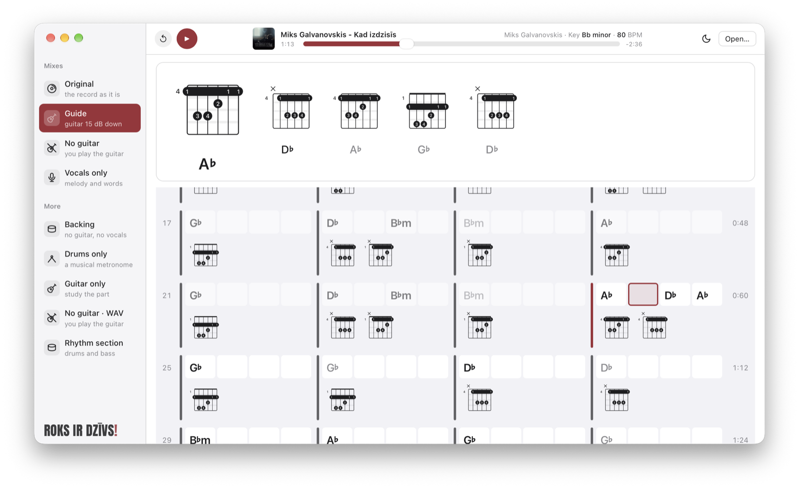

# playalong

> **Heads up to [Miks Galvanovskis](https://www.youtube.com/watch?v=HUHwtDRaHXw).** His
> "Kad izdzisīs" is the song this app was built and tuned on, and the one in the screenshot below.
> Go listen to the original. **Roks ir dzīvs!**

Download a song from YouTube (or use a local file), split it into instrument stems, and render
playalong tracks, mainly for practising guitar.

Two parts: a command-line tool (`src/`) that makes everything, and a small macOS [player app](#player-app)
(`app/`) that plays a mix with the chords following along.


*Playing "Kad izdzisīs" by Miks Galvanovskis.*

Separation uses the BS-RoFormer-SW 6-stem model (`bass`, `drums`, `other`, `vocals`,
`guitar`, `piano`) via [bs-roformer-infer](https://github.com/openmirlab/bs-roformer-infer).

## Setup

```sh
brew install ffmpeg deno   # deno lets yt-dlp solve YouTube's JS challenges
uv sync
```

The model weights (~700 MB) download to `~/.cache/bs-roformer-infer` on first use.

## Usage

```sh
# everything in one go: download, album cover, separate, the four main mixes, chords and the song file
uv run playalong run "https://www.youtube.com/watch?v=..."

# local files and already-processed tracks work too
uv run playalong run ~/Music/song.flac
uv run playalong run library/some-song --all --tempo 0.8

# individual steps
uv run playalong download "https://www.youtube.com/watch?v=..."
uv run playalong separate library/some-song
uv run playalong mix library/some-song -p backing -p guide -f wav
uv run playalong cover library/some-song -q "Artist Song"   # if the cover found is the wrong one

# every mix starts with a drummer's 1-bar count-in at the song's tempo; 2 bars counts
# "ONE . TWO . one two three four"
uv run playalong mix library/some-song -p backing --count-in 2 --tempo 0.8
uv run playalong mix library/some-song --bpm 92          # if the detected tempo is off
uv run playalong mix library/some-song --no-count-in     # straight into the song

# custom mix: any stem at any gain in dB, or off
uv run playalong mix library/some-song -g guitar=-20 -g vocals=-6 --name quiet-guitar
```

## Presets

| preset           | contents                                            |
|------------------|-----------------------------------------------------|
| `original`       | the recording itself, cut and counted in the same   |
| `guide`          | full song, guitar ducked 15 dB: faint reference     |
| `no-guitar`      | full song minus guitar: take over the guitar part   |
| `vocals-only`    | isolated vocals: learn the melody and lyrics        |
| `backing`        | no guitar, no vocals: room for soloing / leads      |
| `rhythm-section` | drums + bass only                                   |
| `drums-only`     | just drums: a musical metronome                     |
| `guitar-only`    | isolated guitar: study the part                     |

`run` and `mix` render the first four (the ones the player shows first) unless told which; `--all`
renders every preset. `--tempo` time-stretches without changing pitch (0.5–2.0).

## Chords

```sh
uv run playalong chords library/some-song
```

prints a bar chart, four bars to a line, and saves next to the stems:

- `chords.html`, a chord sheet to open in a browser or print: the song four bars to a line, each bar
  with four beat cells naming the chords where they start and finger diagrams of its chords, then an
  overview of every chord shape used (open shapes where they exist, E- or A-shape barres otherwise);
- `chords.txt`, the chart below;
- `chords.lab`, start, end and chord in seconds of `source.wav`, for other tools.

```
Key: Ab major   Tempo: 79.9 BPM   (N = no chord; times from the song start)

  1 | Bbm  Ab   | Ab        | Gb        | Gb  Fm    |   0:00
  5 | Fm  Bbm   | Ab        | Ab        | Gb        |   0:12
```

Chords are read from the whole song, the way a listener hears them, with the bass line voting for the
root (the root counts most, the third or fifth for less, since bass lines often sit there). Each
beat gets a major or minor chord or "N" (no chord). A first pass finds the key from which chords
fill the most beats; a second prefers chords in that key when the evidence is close, and a third
lets chords change only on the bar or half bar, with bar lines placed where most changes fall.
A single beat that clearly sounds like another chord inside a held one is kept as a quick chord
("A♭ · D♭ A♭"). The key decides between sharps and flats. On the reference song this agrees with
Chordify on 80% of beats. Sevenths, suspensions and slash chords come out as their nearest triad.

## Song file

Every step writes `library/<song>/<song>.playalong`, a JSON file a player opens to get the whole song;
`run` also detects the chords for it. Paths are relative to the file, times are seconds in
`source.wav`:

| field | contents |
|---|---|
| `format`, `version` | `"playalong-song"`, `1` |
| `title`, `artist`, `source` | metadata and the YouTube link |
| `audio` | `source.wav`, sample rate, duration |
| `song_start` | where the song proper starts (after the video intro) and how that was found |
| `tempo` | BPM, confidence, `detected` or `user`, beats per bar |
| `key`, `beats`, `bars` | the key, every beat and every bar start from the song start on |
| `chords` | start, end, name, root and `major`/`minor` (`N` = no chord) |
| `chord_shapes` | per chord: `frets` and `fingers` low E to high e (`-1` muted, `0` open), `barre` fret and string positions |
| `cover` | `cover.jpg`, where it came from (`itunes` or the `youtube` thumbnail) and the album |
| `stems`, `mixes`, `garageband`, `chord_sheet` | where the audio and the chord sheet are |

Steps that don't detect chords keep the ones already in the file.

## GarageBand

```sh
uv run playalong mix library/some-song --garageband
```

also writes `mixes/<song> - GarageBand <tempo> BPM/` with one WAV per stem (intro cut, no count-in).
In GarageBand choose File > New > Empty Project, set the tempo shown, and drag all six files into
the empty area below the tracks: each gets its own track, and the song's first beat sits on bar 2,
so GarageBand's metronome and count-in match the song. The stems share one gain, so the tracks
at 0 dB add up to the original. GarageBand only takes whole-number tempi and bar lines are a guess
(the beat is found, not which beat is the "one"), so on long or drifting songs the grid can wander a
little; `--bpm` sets the tempo by hand.

## Count-in

Mixes start with a bar of stick clicks, so the music comes in on the beat right after the last
click (`--count-in 2` for two bars, `--no-count-in` for none). The tempo is detected from the drums (bass and guitar when there are none) and
the beat is found where the song starts; both are saved in `info.json` (`bpm`, `beat_offset`),
the same values the [player app](#player-app) uses. A `--bpm` you give is kept for the track from then on.
The clicks follow `--tempo`. A song without a steady beat is mixed without a count-in.

## Video intros

Music videos often open with dialogue, ambience or silence before the song. Mixes start where
the song does:

1. If [SponsorBlock](https://sponsor.ajay.app) has a community-marked non-music intro for the
   video, its end is used.
2. Otherwise the drums, bass, guitar and piano stems are scanned for the first sustained
   playing. Vocals and `other` are ignored because dialogue and sound effects end up there,
   which also means a song that opens a cappella gets its first lines cut.

The result is cached in `info.json` (`song_start`). Override it with `--start 12.5`, or keep
the whole recording with `--no-trim`. Stems are never trimmed.

## Layout

```
library/<song>/
  source.wav     44.1 kHz stereo input
  info.json      YouTube metadata, detected song start
  cover.jpg      album cover from the iTunes catalogue, else the video thumbnail
  stems/         one float WAV per instrument
  mixes/         rendered playalong tracks
```

## Notes

- Separation takes a few minutes per song on Apple Silicon (MPS), longer on CPU.
- Guitar separation is good, not perfect: expect some bleed between `guitar` and `other`,
  especially with keys or synth pads in the same range.

## Player app

A small macOS app (Tauri 2 + Svelte, in `app/`) that opens a song made by the CLI and plays one of its
mixes with the chords following along. During a mix's count-in it shows big numbers in time with the
clicks, then the current chord, the next four, and the song in bars with the playing beat highlighted.

It reads `<song>/<song>.playalong` and plays the mix files next to it; nothing is downloaded or
processed in the app.

```sh
cd app/ui && npm ci && cd ..
ui/node_modules/.bin/tauri build --debug     # or: ui/node_modules/.bin/tauri dev
open target/debug/bundle/macos/Playalong.app
```

`open -a target/debug/bundle/macos/Playalong.app --args <song folder> --at 94` opens a song straight
away, waiting at that time in the song.

Then **Open song folder…** (or drop a folder on the window) and choose a track folder from
`library/`.

- The toolbar sits in the window's title bar: Restart and Play, the album cover with title, key,
  tempo and position, a light/dark toggle (the system's appearance until you use it), and Open.
- The sidebar lists the four main mixes with keys 1–4 (Original, Guide, No guitar, Vocals only), then
  any others. Switching mixes keeps your place in the song.
- The chord strip stays put; only the bars scroll. Click a bar to jump there.
- Keys: Space play/pause · ← → 5 s · Home: back to the start (count-in included) · 1–4 mixes.

The icon is the Fmaj7 shape on a carmine tile (the Latvian flag's red), with a dark variant for the
Mac's dark icon style. `app/scripts/make_icon.py` draws it and `app/scripts/icons.sh` renders the
icon files and compiles `Assets.car` with Xcode's `actool`.

```sh
cd app && cargo test -p playalong-app     # finding and checking song files
cd ui && npm test && npx svelte-check     # timing, count-in, sheet, mixes, theme
```

## License

MIT, see [LICENSE](LICENSE).
